# AHT21B 驱动详细技术文档

## 目标

本文档依据 `Bsp_AHT21B_Driver.c`、`Bsp_AHT21B_Driver.h` 及原《Aht21b详细设计模板.md》的章节框架编写。文档描述的是当前源码的真实行为，不把 TODO、空函数或注释中的设想当作已经实现的功能。

## 参考代码

| 文件                    | 作用                                        |
| --------------------- | ----------------------------------------- |
| `Bsp_AHT21B_Driver.c` | AHT21B 驱动实现，包含实例化、初始化、状态读取、测量读取、反初始化及预留接口 |
| `Bsp_AHT21B_Driver.h` | 宏、状态码、I²C/时基/RTOS 接口、驱动对象及公开实例化函数声明       |
| `Aht21b详细设计模板.md`     | 本文档的章节和表格组织参考                             |

## 单元详细设计

### 1.BSP（本设备属于驱动层）

#### 1.1. AHT21B

##### 1.1.1.Bsp_AHT21B_Driver

###### 1.1.1.1.文件描述

该组件位于 BSP 层，通过注入的 I²C 接口与 AHT21B 温湿度传感器交互。当前实现提供：

1. 驱动对象实例化和外部接口挂载；
2. 软件 I²C 模式下的临界区保护；
3. I²C 总线初始化；
4. 通过 `0x71` 读取状态字；
5. 发送 `0xAC, 0x33, 0x00` 测量命令并读取 6 字节数据及可选 CRC 字节的事务骨架；
6. 初始化/反初始化状态管理。

温湿度物理量解析、CRC 校验、异常状态初始化、ID 的真实读取、休眠和唤醒目前仍为未完成或预留功能。

###### 1.1.1.2.组件资源描述

当前工程未提供该组件对应的 ELF/AXF、map 文件或编译器报告，不能可靠给出 ROM/RAM 字节数。源码层面可确认：

| 资源     | 当前可确认内容                                                                                                       |
| ------ | ------------------------------------------------------------------------------------------------------------- |
| 静态 RAM | 头文件中定义了 `static int8_t g_aht21b_inited` 和 `static uint8_t g_device_id`；由于它们位于头文件，若被多个 `.c` 包含，会在每个翻译单元各生成一份副本 |
| 栈 RAM  | 测量函数使用若干 `uint8_t` 局部变量，无动态内存                                                                                 |
| ROM    | 由实际编译器、优化等级、是否启用 `DEBUG`、链接的 I²C 实现决定，须以 map 文件为准                                                             |
| 动态内存   | 源码未调用 malloc/calloc/free                                                                                      |

建议在完成编译后记录链接 map 中各函数的 `.text` 和静态对象的 `.bss/.data`，再替换本节的定量数据。

###### 1.1.1.3.头文件引用

| No. | 文件名称                  | 描述                                       |
| ---:| --------------------- | ---------------------------------------- |
| 1   | `Bsp_AHT21B_Driver.h` | 本组件头文件；源文件直接包含                           |
| 2   | `stdint.h`            | 提供 `uint8_t`、`uint32_t`、`int8_t` 等定宽整数类型 |
| 3   | `stdio.h`             | 源文件用于 `printf` 调试输出                      |
| 4   | 外部 I²C 实现头文件          | 不由本组件直接包含；通过 `IIC_DriverInterface_t` 注入  |

模板中的 `ec_bsp_aht21_reg.h`、`elog.h` 在当前 AHT21B 源码中并未引用，不能列为实际依赖。

###### 1.1.1.4.全局定义（非本组件自己的内容）

###### 1.1.1.4.1.全局宏

| No. | 宏名称            | 来源         | 描述                                 |
| ---:| -------------- | ---------- | ---------------------------------- |
| 1   | `NULL`         | C 运行库/编译环境 | 空指针常量，源码用于参数检查                     |
| 2   | `HARDWARE_IIC` | 工程编译配置（可选） | 定义时选择硬件 I²C 接口结构；未定义时使用软件 I²C 接口结构 |

`OS_SUPPORTING`、`DEBUG` 和所有 AHT21B 命令宏均由本组件头文件自己定义，归入组件定义。

###### 1.1.1.4.2.全局类型声明

| No. | 类型                            | 来源         | 用途           |
| ---:| ----------------------------- | ---------- | ------------ |
| 1   | `uint8_t`、`uint32_t`、`int8_t` | `stdint.h` | 字节、时间及状态标志   |
| 2   | `float`                       | C 语言内建类型   | 预留的温湿度输出接口参数 |

###### 1.1.1.4.3.全局变量声明

当前源码没有引用其他组件导出的全局变量。I²C、时基和 RTOS 能力均通过函数指针结构体传入。

###### 1.1.1.5.组件定义

###### 1.1.1.5.1.组件宏定义

| 宏名称                                 | 值                | 描述/当前状态                               |
| ----------------------------------- | ----------------:| ------------------------------------- |
| `OS_SUPPORTING`                     | 已定义              | 编译 RTOS 延时接口成员和参数                     |
| `DEBUG`                             | 已定义              | 启用 `printf` 错误/实例化信息                  |
| `AHT21B_STATUS_CMD_CODE`            | `0x71`           | 读状态/读测量结果使用的总线字节                      |
| `AHT21B_REG_WRITE_ADDR`             | `0x70`           | 写地址字节；当前测量代码实际也错误地使用了状态宏发送 `0x71`     |
| `STATUS_CHECK_AND_CODE`             | `0x18`           | 状态字节检查掩码；要求 `(status & 0x18) == 0x18` |
| `TRIGGER_MEASURE_CODE`              | `0xAC`           | 触发测量命令                                |
| `TRIGGER_MEASURE_PAR_1`             | `0x33`           | 测量命令参数 1                              |
| `TRIGGER_MEASURE_PAR_2`             | `0x00`           | 测量命令参数 2                              |
| `INIT_ABNORMAL_REG_1/2/3`           | `0x1B/0x1C/0x1E` | 异常初始化寄存器占位定义，当前未执行                    |
| `ORIGIN_DATA_LENGTH`                | `6`              | 原始测量数据长度定义                            |
| `CRC_ENABLE`                        | 已定义              | 编译 CRC 数据路径                           |
| `CRC_POLYNOMIAL`                    | 空值               | 未完成的宏；不能用于实际 CRC 计算                   |
| `TRANSFORMED_DATA_LENGTH`           | `6`/`5`          | 依据 `CRC_ENABLE` 条件编译，当前没有实际解析使用       |
| `AHT21B_MEASURE_WAITING_TIME`       | `100`            | 预期测量等待时间，当前代码未使用                      |
| `AHT21B_INITED`/`AHT21B_NOT_INITED` | `1`/`0`          | 初始化状态标志                               |
| `AHT21B_ID`                         | 空值               | 未完成的 ID 定义                            |
| `CRC8_POLYNOMIAL`                   | `0x31`           | CRC-8 多项式参数注释为 `1+x^4+x^5+x^8`        |
| `CRC8_INITAL`                       | `0xFF`           | CRC 初值（宏名称拼写为 `INITIAL` 的误写形式）        |

###### 1.1.1.5.2.组件数据类型定义

**`BspAht21bStatus_t`**：组件统一状态码。

| 枚举值                                | 数值     | 含义               |
| ---------------------------------- | ------:| ---------------- |
| `AHT21B_STATUS_OK`                 | 0      | 操作成功             |
| `AHT21B_STATUS_ERROR`              | 1      | 通用错误             |
| `AHT21B_STATUS_ERROR_TIMEOUT`      | 2      | 超时               |
| `AHT21B_STATUS_ERROR_RESOURCE`     | 3      | 资源占用、重复初始化或未满足状态 |
| `AHT21B_STATUS_ERROR_PARAMETER`    | 4      | 参数无效             |
| `AHT21B_STATUS_ERROR_NO_MEMORY`    | 5      | 内存不足（当前未使用）      |
| `AHT21B_STATUS_ERROR_ISR`          | 6      | 中断上下文错误（当前未使用）   |
| `AHT21B_STATUS_ERROR_NULL_POINTER` | 7      | 空指针              |
| `AHT21B_STATUS_RESERVED`           | `0xFF` | 保留               |

**`IIC_DriverInterface_t`**：

- 未定义 `HARDWARE_IIC` 时，包含初始化、反初始化、起始、停止、等待 ACK、发送 ACK/NACK、收发字节和临界区进入/退出，共 11 个函数指针，返回 `BspAht21bStatus_t`。
- 定义 `HARDWARE_IIC` 时，切换为另一套不完整接口，函数签名和软件 I²C 版本不同，且没有 `Start/Stop/WaitACK/Critical` 成员。当前 `.c` 使用的调用方式明显对应软件 I²C 版本。

**`BspAht21b_TimeBaseInterface_t`**：包含 `uint32_t (*pf_GetTickCount)(void)`，当前实现未调用。

**`BspAht21b_RTOS_YieldInterface_t`**：包含 `void (*pf_RTOS_Yield)(const uint32_t)`，用于初始化前让出 CPU；当前初始化固定传入 `100`。

**`Bsp_Aht21b_Driver_t`**：驱动对象，保存三类外部接口，并保存实例化、初始化、反初始化、读 ID、读温湿度、读湿度、休眠和唤醒函数指针。

###### 1.1.1.5.3.组件变量定义

| 数据名称              | 类型               | 初值  | 读函数                         | 写函数        | 描述                        |
| ----------------- | ---------------- | ---:| --------------------------- | ---------- | ------------------------- |
| `g_aht21b_inited` | `static int8_t`  | `0` | 初始化、反初始化、状态读取、测量读取、湿度、休眠、唤醒 | 初始化/反初始化   | 全局初始化状态；放在头文件会造成多翻译单元副本风险 |
| `g_device_id`     | `static uint8_t` | `0` | 当前没有有效读取路径                  | 当前没有有效写入路径 | 预留设备 ID 存储                |

###### 1.1.1.6.软件函数

###### 1.1.1.6.1. `pAht21b_DriverInst`

**函数简介**：检查外部接口指针，挂载 I²C、时基、RTOS 延时接口，并把内部操作函数挂载到驱动对象。

**函数全称**：

```c
uint8_t pAht21b_DriverInst(
    Bsp_Aht21b_Driver_t * const pAht21bInstance,
    IIC_DriverInterface_t * const pIIC_DriverInstance,
    BspAht21b_TimeBaseInterface_t * const pTimeBaseInterface,
    BspAht21b_RTOS_YieldInterface_t * const pRTOS_YieldInstance);
```

**输入/输出**：`pAht21bInstance` 是输出对象；其余三个是输入接口对象。源码没有检查 `pAht21bInstance` 本身是否为空，这是必须修正的缺陷。

**调用函数**：无外部函数调用；仅赋值函数指针。

**局部变量**：无。

**逻辑**：

1. 检查 I²C、时基、RTOS 接口是否为空；为空返回 `AHT21B_STATUS_ERROR_NULL_POINTER`。
2. 若全局状态已为 `AHT21B_INITED`，返回 `AHT21B_STATUS_ERROR_RESOURCE`。
3. 保存三个外部接口地址。
4. 挂载 `Init/DeInit/ReadID/ReadTempHumi/ReadHumi/Sleep/WakeUp` 函数。
5. 不执行传感器硬件初始化，也不改变 `g_aht21b_inited`。

**返回值**：成功返回 0；空指针返回 7；已初始化返回 3。函数声明返回 `uint8_t`，但实现返回的是 `BspAht21bStatus_t` 枚举值，数值兼容但类型表达不一致。

###### 1.1.1.6.2. `BspAht21bDriver_Init`

**函数简介**：执行 RTOS 延时、进入软件 I²C 临界区、初始化 I²C、尝试读取 ID，并置初始化标志。

**调用序列**：`pf_RTOS_Yield(100)` → `pf_CriticalEnter(NULL)` → `pf_IIC_Init(NULL)` → `__ReadAht21bID()` → `pf_CriticalExit(NULL)`。

**局部变量**：无。

**逻辑和问题**：

1. 检查驱动对象为空；为空返回 7。
2. 若已初始化返回 3。
3. 无条件解引用 `pRTOS_YieldInstance` 和软件 I²C 临界区函数指针，未逐项检查。
4. 忽略 `pf_IIC_Init` 和 `__ReadAht21bID` 的返回值。
5. 无论传感器是否可用，都将 `g_aht21b_inited` 置为 1 并返回成功。

因此当前“初始化成功”只表示代码路径走完，不代表 AHT21B 已被识别或总线初始化成功。

###### 1.1.1.6.3. `BspAht21bDriver_DeInit`

检查驱动对象和当前初始化状态；未初始化返回资源错误，已初始化则仅把 `g_aht21b_inited` 清零并返回成功。不会调用 `pf_IIC_DeInit`，不会释放或复位任何硬件资源。

<style> td {white-space:nowrap;border:0.5pt solid #dee0e3;font-size:10pt;font-style:normal;font-weight:normal;vertical-align:middle;word-break:normal;word-wrap:normal;}</style>

###### 1.1.1.6.4. `BspAht21bDriver_ReadAht21bStatus`

**功能**：读取一个状态字并检查状态掩码。

**总线事务**（软件 I²C）：进入临界区 → Start → 发送 `0x71` → 等待 ACK → 接收 1 字节 → 发送 NACK → Stop → 退出临界区。

**判断**：若 `(rece_status_byte & 0x18) != 0x18`，进入异常初始化 TODO 分支；否则返回 `AHT21B_STATUS_OK`。

**当前缺陷**：异常分支没有返回语句；I²C 每一步返回值均被忽略；状态命令的地址/命令语义需要结合实际 AHT21B 数据手册再次确认。

###### 1.1.1.6.5. `BspAht21bDriver_ReadTemperaHumi`

**函数简介**：执行一次测量事务并接收状态、湿度/温度原始字节和可选 CRC。

**原型**：`BspAht21bStatus_t BspAht21bDriver_ReadTemperaHumi(Bsp_Aht21b_Driver_t * const, uint8_t *);`

注意：对象中的函数指针声明为 `uint8_t (*)(void * const, float * const temp)`，与该静态函数的参数类型和含义不匹配；当前实例化赋值会产生函数指针类型不兼容风险，不能按“返回 float 温湿度”使用。

**发送阶段**：临界区 → Start → 发送 `AHT21B_STATUS_CMD_CODE`（源码注释写“发送 0x70”，实际值是 `0x71`）→ ACK → 发送 `0xAC`、`0x33`、`0x00`，每字节后等待 ACK → Stop → 退出临界区。

**等待阶段**：源码留有两处“等待 80 ms 测量完成”的 TODO，实际没有延时。

**接收阶段**：再次进入临界区并 Start；调用 `BspAht21bDriver_ReadAht21bStatus`；依次接收 5 个数据字节，每个前 4 个发送 ACK，第 5 个后在 CRC 开启时发送 ACK；若开启 CRC，再接收 1 字节 CRC；发送 NACK、Stop、退出临界区。

**局部变量**：状态/数据字节共 6 个、`data_crc` 1 个，均初始化为 0；参数 `tempera_humi` 从未写入。

**未完成项**：没有 10 ms/80 ms 等待、没有检查测量忙状态、没有 CRC 计算/比较、没有温湿度位拼接和物理量换算、没有把结果写入输出缓冲区、没有传播底层错误。因此不能认为该函数已经实现可用的温湿度读取。

###### 1.1.1.6.6. `BspAht21bDriver_ReadHumidity`

检查驱动对象、输出 `float *humi` 和初始化状态；通过后没有任何 I²C 读取或赋值操作，直接返回成功。属于预留接口，当前返回值不能代表湿度有效。

###### 1.1.1.6.7. `BspAht21bDriver_Sleep`

检查对象和初始化状态后直接返回成功，没有发送休眠命令，也没有改变硬件或软件状态。属于预留接口。

###### 1.1.1.6.8. `BspAht21bDriver_WakeUp`

检查对象和初始化状态后直接返回成功，没有执行唤醒总线事务或等待。属于预留接口。

###### 1.1.1.6.9. `__ReadAht21bID`

当前仅检查驱动对象是否为空；非空时函数到达末尾，没有执行 I²C 读取，也没有返回值。该函数被初始化调用，但其结果被忽略。AHT21B 是否存在独立可读 ID，应以具体型号数据手册为准，不能用空的 `AHT21B_ID` 宏推断。

###### 1.1.1.6.10. `BspAht21bDriver_GetAht21bID`

检查驱动对象后，函数体没有读取或返回 `g_device_id`，到达末尾无返回值。对象中的 `pfAht21b_ReadID` 指向该函数，因此当前读 ID 接口不可用。

###### 1.1.1.6.11. `BspAht21bDriver_CheckCRC8`

定义了无参数的静态 CRC 检查函数，但函数体为空且无返回值。虽然 `CRC_ENABLE` 已定义，当前并不存在可执行的 CRC 校验。

###### 1.1.1.7.动态行为

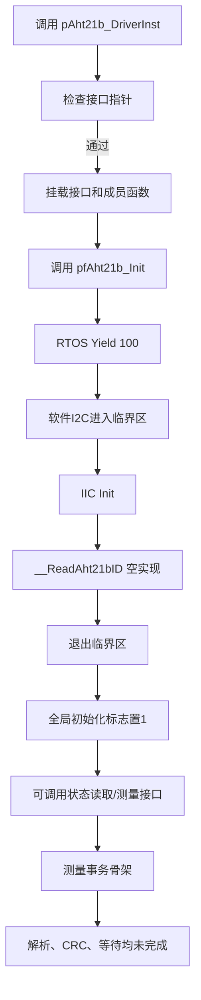

## 2. I²C 事务和数据格式

### 2.1 状态读取

当前代码期望收到 1 字节状态值，并检查位掩码 `0x18`。源码表达式为：

```c
(rece_status_byte & STATUS_CHECK_AND_CODE) == STATUS_CHECK_AND_CODE
```

状态异常时预留向 `0x1B/0x1C/0x1E` 相关寄存器写入初始化配置，但写寄存器流程没有实现。

### 2.2 测量命令

代码计划发送：

```text
0xAC  0x33  0x00
```

在命令发送前后应补充型号手册规定的初始化等待、测量转换等待和忙状态轮询。当前宏 `AHT21B_MEASURE_WAITING_TIME=100` 没有被使用。

### 2.3 接收长度和 ACK/NACK

代码局部变量表示 6 个数据字节：状态/湿度高字节/湿度低字节与温度拼接字节/温度高字节/温度低字节；`CRC_ENABLE` 时另接收 1 字节 CRC。前 5 个数据字节按连续读取发送 ACK，最后一个字节发送 NACK 后 Stop。由于没有数据手册核对和解析代码，本节只描述源码事务，不保证字节含义已经适配 AHT21B 变体。

## 3. 接口使用约束

1. 必须先准备完整的 `IIC_DriverInterface_t`、`BspAht21b_TimeBaseInterface_t` 和 `BspAht21b_RTOS_YieldInterface_t` 实例，再调用 `pAht21b_DriverInst`。
2. 当前源码应仅在未定义 `HARDWARE_IIC` 的软件 I²C 配置下使用；硬件 I²C 分支缺少 `.c` 实际调用所需的成员。
3. 实例化成功不等于传感器初始化成功；在修复错误传播前，调用方不能只依据返回 0 判断器件在线。
4. I²C 接口的 `void *` 参数当前统一传 `NULL`，因此外部驱动若依赖上下文对象，需要扩展接口或增加实例上下文字段。
5. `g_aht21b_inited` 为文件头中的 `static` 变量，建议移入 `.c` 并由对象字段保存状态，以避免多实例和多翻译单元状态不一致。

## 4. 已知问题与修复优先级

| 优先级 | 问题                                            | 影响                 | 建议                                    |
| --- | --------------------------------------------- | ------------------ | ------------------------------------- |
| P0  | 多个非 `void` 函数到达末尾无返回值                         | 未定义行为，编译器可能告警或优化出错 | 为所有路径补齐返回值，并启用 `-Wreturn-type`        |
| P0  | `ReadTemperaHumi` 函数指针声明与实现签名不一致              | 调用约定/参数解释错误        | 统一为明确的 `BspAht21bStatus_t` 原型和温湿度输出参数 |
| P0  | 测量代码把 `AHT21B_STATUS_CMD_CODE(0x71)` 当作写事务首字节 | 可能导致器件不响应          | 区分写地址 `0x70`、读地址 `0x71` 及命令字节，按手册重写事务 |
| P0  | 初始化忽略 I²C 和 ID 读取错误                           | 虚假报告初始化成功          | 逐级检查并传播返回值，成功后再置位 initialized         |
| P1  | 80 ms 等待、忙状态轮询未实现                             | 读到旧数据或无效数据         | 使用时基或 RTOS 延时，并设置超时                   |
| P1  | CRC 函数为空，`CRC_POLYNOMIAL` 为空宏                 | 无法发现总线数据损坏         | 实现 CRC-8 多项式 `0x31`、初值并比较接收 CRC       |
| P1  | 温湿度解析未实现                                      | 输出缓冲区保持原值          | 按型号手册拼接 20 位原始值并换算物理量                 |
| P1  | `pAht21bInstance` 未检查为空                       | 可能空指针写入            | 在实例化入口首先检查该参数                         |
| P2  | `pf_GetTickCount`、`pf_IIC_DeInit` 未使用         | 超时和资源释放缺失          | 增加统一超时和反初始化路径                         |
| P2  | `DEBUG` 在头文件无条件定义                             | 所有包含者都产生调试输出       | 改为工程编译选项或独立配置宏                        |
| P2  | 全局状态不支持多实例                                    | 多个 AHT21B 互相影响     | 将状态和 ID 放入 `Bsp_Aht21b_Driver_t`      |

## 5. 单元测试建议

| 用例                  | 注入/观测                   | 预期                                         |
| ------------------- | ----------------------- | ------------------------------------------ |
| 空 I²C/时基/RTOS 指针实例化 | 分别传入 NULL               | 返回 `AHT21B_STATUS_ERROR_NULL_POINTER`，不写对象 |
| 空对象实例化              | `pAht21bInstance=NULL`  | 返回空指针错误，不崩溃                                |
| 重复初始化               | 两次调用 `pfAht21b_Init`    | 第二次返回资源错误                                  |
| I²C 初始化失败           | mock `pf_IIC_Init` 返回错误 | 修复后初始化失败且不置 initialized                    |
| 状态异常                | mock 返回状态位不满足 `0x18`    | 进入明确的异常初始化/错误返回路径                          |
| 测量忙超时               | 始终返回 busy               | 在规定超时内返回 timeout                           |
| CRC 错误              | 修改第 7 字节 CRC            | 返回 CRC/通用错误，不输出数据                          |
| 数据换算                | 使用手册已知原始帧               | 温度、湿度与期望值误差在规定范围内                          |
| 并发访问                | 两个任务同时读写                | 临界区或互斥机制保证事务不交错                            |
| 反初始化                | 初始化后调用 DeInit           | 释放/复位 I²C 资源并清除对象状态                        |

## 6. 结论

当前代码适合作为 AHT21B 驱动的接口和 I²C 事务实验骨架，不适合作为已经验收的温湿度驱动。完成 P0/P1 项后，才能进行真实板级数据验证；完成 map 统计、CRC/超时、解析和错误传播后，才能形成可交付的 BSP 组件。

## 7. 函数逐项详细设计表（按模板七项结构补齐）

本节专门对应模板中每个函数要求的七项内容：1）函数简介；2）函数全称及参数表；3）交互数据；4）函数调用；5）函数局部变量；6）函数逻辑描述；7）函数流程图。流程图使用 Mermaid 表示，当前未实现路径也明确标注。

### 7.1 `pAht21b_DriverInst`

#### 7.1.1 函数简介

创建 AHT21B 驱动实例，保存外部 I²C、时基和 RTOS 延时接口，并挂载驱动操作函数。

#### 7.1.2 函数全称及参数表

```c
uint8_t pAht21b_DriverInst(Bsp_Aht21b_Driver_t * const pAht21bInstance,
                           IIC_DriverInterface_t * const pIIC_DriverInstance,
                           BspAht21b_TimeBaseInterface_t * const pTimeBaseInterface,
                           BspAht21b_RTOS_YieldInterface_t * const pRTOS_YieldInstance);
```

| 方向  | 数据名称                  | 类型                                  | 范围  | 描述                     |
| --- | --------------------- | ----------------------------------- | --- | ---------------------- |
| 输出  | `pAht21bInstance`     | `Bsp_Aht21b_Driver_t *`             | 调用者 | 接收挂载后的驱动对象；当前源码未检查其空指针 |
| 输入  | `pIIC_DriverInstance` | `IIC_DriverInterface_t *`           | 调用者 | I²C 操作接口               |
| 输入  | `pTimeBaseInterface`  | `BspAht21b_TimeBaseInterface_t *`   | 调用者 | 时基接口                   |
| 输入  | `pRTOS_YieldInstance` | `BspAht21b_RTOS_YieldInterface_t *` | 调用者 | RTOS 延时接口              |
| 返回  | `uint8_t`             | 状态值                                 | 调用者 | 0 成功，3 资源错误，7 空指针错误    |

#### 7.1.3 交互数据

| 方向  | 数据                                     | 范围     | 描述           |
| --- | -------------------------------------- | ------ | ------------ |
| 写   | `pAht21bInstance->pIIC_DriverInstance` | 组件对象   | 保存 I²C 接口地址  |
| 写   | `pAht21bInstance->pTimeBaseInterface`  | 组件对象   | 保存时基接口地址     |
| 写   | `pAht21bInstance->pRTOS_YieldInstance` | 组件对象   | 保存 RTOS 接口地址 |
| 写   | `pfAht21b_Init` 等函数指针                  | 组件对象   | 挂载内部实现       |
| 读   | `g_aht21b_inited`                      | 组件静态变量 | 防止重复实例化      |

#### 7.1.4 函数调用

| 函数                                                  | 所属组件 | 用途          |
| --------------------------------------------------- | ---- | ----------- |
| `BspAht21bDriver_Init`、`DeInit`、`ReadTemperaHumi` 等 | 本组件  | 写入对象的成员函数指针 |

#### 7.1.5 函数局部变量

| 数据名称 | 类型  | 初值  | 范围  | 描述      |
| ---- | --- | --- | --- | ------- |
| 无    | —   | —   | —   | 函数无局部变量 |

#### 7.1.6 函数逻辑描述

①检查三个外部接口；②检查全局初始化标志；③保存接口地址；④挂载七个操作函数；⑤返回状态。实例化不执行传感器 I²C 操作。

#### 7.1.7 函数流程图

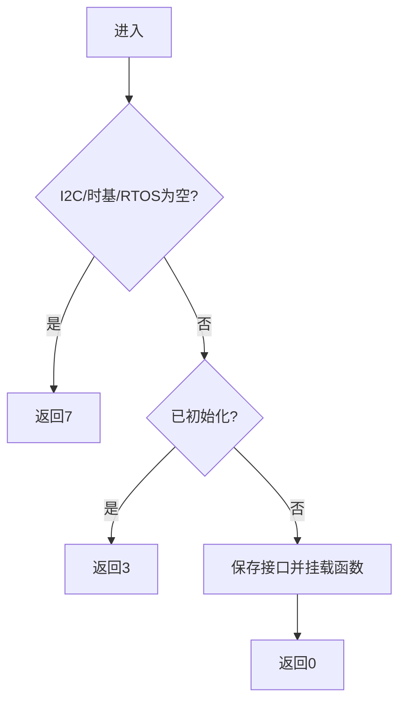

### 7.2 `BspAht21bDriver_Init`

#### 7.2.1 函数简介

初始化软件 I²C、尝试读取传感器 ID，并设置组件初始化状态。

#### 7.2.2 函数全称及参数表

```c
static BspAht21bStatus_t BspAht21bDriver_Init(Bsp_Aht21b_Driver_t * const aht21b_driver);
```

| 方向  | 数据名称                | 类型                      | 描述       |
| --- | ------------------- | ----------------------- | -------- |
| 输入  | `aht21b_driver`     | `Bsp_Aht21b_Driver_t *` | 已实例化驱动对象 |
| 返回  | `BspAht21bStatus_t` | 枚举                      | 初始化结果    |

#### 7.2.3 交互数据

| 方向  | 数据                    | 范围     | 描述             |
| --- | --------------------- | ------ | -------------- |
| 读写  | `g_aht21b_inited`     | 组件静态变量 | 检查并置为 1        |
| 读   | `pRTOS_YieldInstance` | 外部接口   | 调用延时           |
| 读   | `pIIC_DriverInstance` | 外部接口   | 调用 I²C 初始化和临界区 |

#### 7.2.4 函数调用

| 函数                      | 所属组件     | 用途          |
| ----------------------- | -------- | ----------- |
| `pf_RTOS_Yield(100)`    | RTOS 适配层 | 让出 CPU      |
| `pf_CriticalEnter/Exit` | I²C 适配层  | 保护软件 I²C 事务 |
| `pf_IIC_Init`           | I²C 适配层  | 初始化总线       |
| `__ReadAht21bID`        | 本组件      | 尝试读取 ID     |

#### 7.2.5 函数局部变量

| 数据名称 | 类型  | 初值  | 描述    |
| ---- | --- | --- | ----- |
| 无    | —   | —   | 无局部变量 |

#### 7.2.6 函数逻辑描述

①检查对象；②拒绝重复初始化；③延时 100；④软件 I²C 进入临界区；⑤初始化 I²C 并调用 ID 读取；⑥退出临界区；⑦无论底层结果如何都置位并返回成功（现有缺陷）。

#### 7.2.7 函数流程图

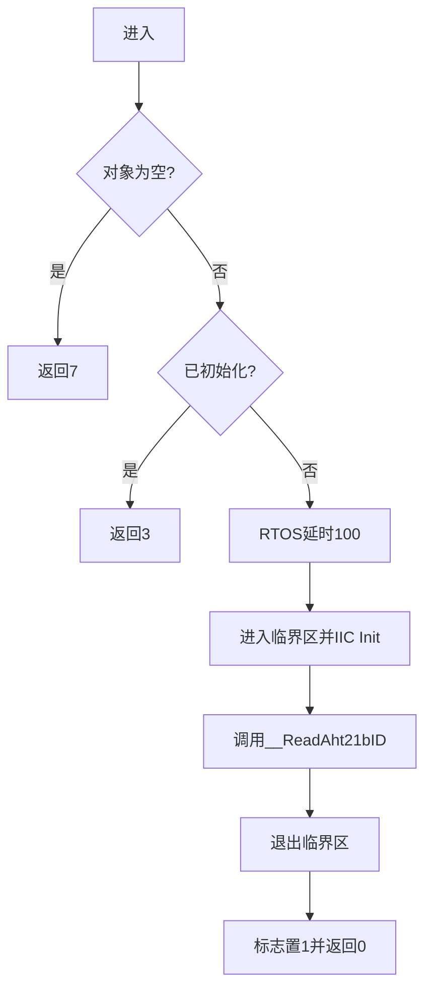

### 7.3 `BspAht21bDriver_DeInit`

#### 7.3.1 函数简介

清除组件的软件初始化标志。当前不释放 I²C 硬件资源。

#### 7.3.2 函数全称及参数表

```c
static BspAht21bStatus_t BspAht21bDriver_DeInit(Bsp_Aht21b_Driver_t * const aht21b_driver);
```

| 方向  | 数据名称            | 类型                      | 描述           |
| --- | --------------- | ----------------------- | ------------ |
| 输入  | `aht21b_driver` | `Bsp_Aht21b_Driver_t *` | 驱动对象，仅做空指针检查 |
| 返回  | 状态值             | `BspAht21bStatus_t`     | 成功或资源/空指针错误  |

#### 7.3.3 交互数据

| 方向  | 数据                | 范围     | 描述    |
| --- | ----------------- | ------ | ----- |
| 读写  | `g_aht21b_inited` | 组件静态变量 | 检查后清零 |

#### 7.3.4 函数调用

| 函数  | 所属组件 | 用途               |
| --- | ---- | ---------------- |
| 无   | —    | 当前实现没有调用外部资源释放函数 |

#### 7.3.5 函数局部变量

| 数据名称 | 类型  | 初值  | 描述    |
| ---- | --- | --- | ----- |
| 无    | —   | —   | 无局部变量 |

#### 7.3.6 函数逻辑描述

检查对象；若未初始化返回资源错误；否则清除标志并返回成功。

#### 7.3.7 函数流程图

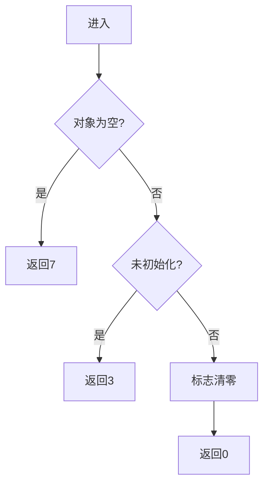

### 7.4 `BspAht21bDriver_ReadAht21bStatus`

#### 7.4.1 函数简介

通过软件 I²C 读取一个状态字，并用 `0x18` 掩码判断状态。

#### 7.4.2 函数全称及参数表

```c
static BspAht21bStatus_t BspAht21bDriver_ReadAht21bStatus(Bsp_Aht21b_Driver_t * const aht21b_driver);
```

| 方向  | 数据名称            | 类型                      | 描述                |
| --- | --------------- | ----------------------- | ----------------- |
| 输入  | `aht21b_driver` | `Bsp_Aht21b_Driver_t *` | 驱动对象和 I²C 接口      |
| 返回  | 状态值             | `BspAht21bStatus_t`     | 状态检查结果；异常分支当前缺少返回 |

#### 7.4.3 交互数据

| 方向  | 数据                       | 范围  | 描述          |
| --- | ------------------------ | --- | ----------- |
| 写   | `rece_status_byte`       | 局部  | 接收状态字       |
| 读   | `AHT21B_STATUS_CMD_CODE` | 组件宏 | 发送 `0x71`   |
| 读   | `STATUS_CHECK_AND_CODE`  | 组件宏 | 状态掩码 `0x18` |

#### 7.4.4 函数调用

| 函数                      | 所属组件    | 用途      |
| ----------------------- | ------- | ------- |
| `pf_CriticalEnter/Exit` | I²C 适配层 | 保护事务    |
| `pf_IIC_Start/Stop`     | I²C 适配层 | 总线起止    |
| `pf_IIC_SendByte`       | I²C 适配层 | 发送状态命令  |
| `pf_IIC_WaitACK`        | I²C 适配层 | 等待从机确认  |
| `pf_IIC_ReceiveByte`    | I²C 适配层 | 接收状态字   |
| `pf_IIC_SendNACK`       | I²C 适配层 | 结束单字节读取 |

#### 7.4.5 函数局部变量

| 数据名称               | 类型        | 初值  | 范围    | 描述     |
| ------------------ | --------- | ---:| ----- | ------ |
| `rece_status_byte` | `uint8_t` | 0   | 0~255 | 接收的状态字 |

#### 7.4.6 函数逻辑描述

检查对象和初始化状态；执行 Start、发送 `0x71`、接收 1 字节、NACK、Stop；若掩码匹配返回成功，否则进入未实现异常初始化分支。

#### 7.4.7 函数流程图

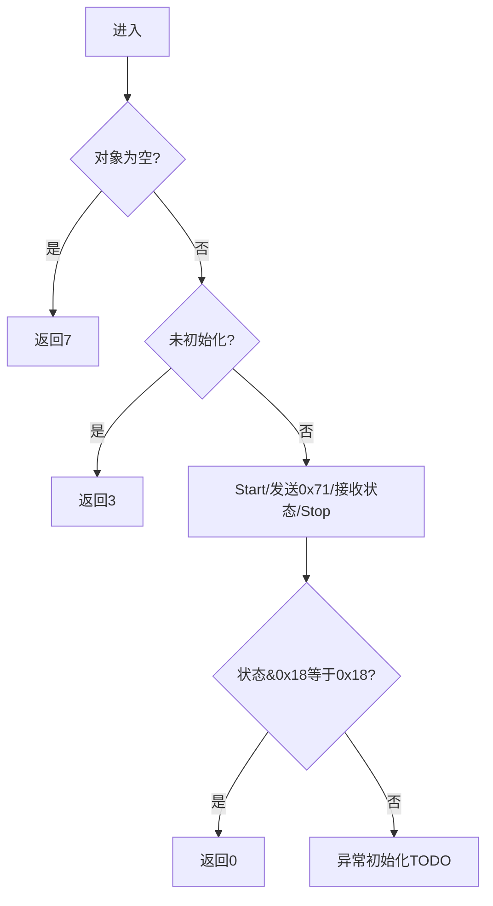

### 7.5 `BspAht21bDriver_ReadTemperaHumi`

#### 7.5.1 函数简介

发送测量命令并接收原始帧，是当前温湿度读取的事务骨架。

#### 7.5.2 函数全称及参数表

```c
static BspAht21bStatus_t BspAht21bDriver_ReadTemperaHumi(
    Bsp_Aht21b_Driver_t * const aht21b_driver, uint8_t * tempera_humi);
```

| 方向  | 数据名称            | 类型                      | 描述             |
| --- | --------------- | ----------------------- | -------------- |
| 输入  | `aht21b_driver` | `Bsp_Aht21b_Driver_t *` | 驱动对象           |
| 输出  | `tempera_humi`  | `uint8_t *`             | 预期接收原始数据；当前未写入 |
| 返回  | 状态值             | `BspAht21bStatus_t`     | 当前事务无条件返回成功    |

#### 7.5.3 交互数据

| 方向  | 数据                                   | 范围  | 描述        |
| --- | ------------------------------------ | --- | --------- |
| 读   | `TRIGGER_MEASURE_CODE/PAR_1/PAR_2`   | 组件宏 | 测量命令和参数   |
| 写   | `data_1_status`~`data_6_temperature` | 局部  | 接收帧字节     |
| 写   | `data_crc`                           | 局部  | 接收 CRC 字节 |
| 读   | `AHT21B_MEASURE_WAITING_TIME`        | 组件宏 | 当前未实际使用   |

#### 7.5.4 函数调用

| 函数                                 | 所属组件    | 用途     |
| ---------------------------------- | ------- | ------ |
| I²C Start/Stop/SendByte/WaitACK    | I²C 适配层 | 发送测量命令 |
| I²C ReceiveByte/SendACK/NACK       | I²C 适配层 | 读取测量帧  |
| `BspAht21bDriver_ReadAht21bStatus` | 本组件     | 读取状态   |
| 临界区函数                              | I²C 适配层 | 防止事务交错 |

#### 7.5.5 函数局部变量

| 数据名称                      | 类型        | 初值  | 描述                |
| ------------------------- | --------- | ---:| ----------------- |
| `data_1_status`           | `uint8_t` | 0   | 状态/首字节            |
| `data_2_humidity`         | `uint8_t` | 0   | 湿度数据字节            |
| `data_3_humidity`         | `uint8_t` | 0   | 湿度数据字节            |
| `data_4_humi_temperature` | `uint8_t` | 0   | 湿度/温度拼接字节         |
| `data_5_temperature`      | `uint8_t` | 0   | 温度数据字节            |
| `data_6_temperature`      | `uint8_t` | 0   | 温度数据字节            |
| `data_crc`                | `uint8_t` | 0   | CRC 字节，启用 CRC 时使用 |

#### 7.5.6 函数逻辑描述

检查输入和初始化状态；发送测量命令；预留等待；接收状态和数据字节；预留 CRC 校验与物理量解析；当前未写输出、不等待、不校验，最后返回成功。

#### 7.5.7 函数流程图

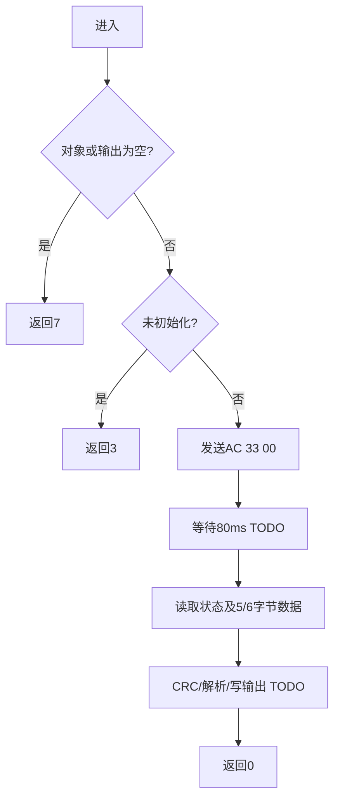

### 7.6 `BspAht21bDriver_ReadHumidity`

#### 7.6.1 函数简介

预留的单独湿度读取接口；当前只做参数和状态检查。

#### 7.6.2 函数全称及参数表

```c
static BspAht21bStatus_t BspAht21bDriver_ReadHumidity(Bsp_Aht21b_Driver_t * const aht21b_driver, float * const humi);
```

| 方向  | 数据名称            | 类型                      | 描述          |
| --- | --------------- | ----------------------- | ----------- |
| 输入  | `aht21b_driver` | `Bsp_Aht21b_Driver_t *` | 驱动对象        |
| 输出  | `humi`          | `float *`               | 湿度输出；当前未写入  |
| 返回  | 状态值             | `BspAht21bStatus_t`     | 当前检查通过即返回成功 |

#### 7.6.3 交互数据

| 方向  | 数据                | 范围   | 描述          |
| --- | ----------------- | ---- | ----------- |
| 读   | `g_aht21b_inited` | 静态变量 | 检查初始化状态     |
| 写   | `humi`            | 调用者  | 预期输出，当前无写操作 |

#### 7.6.4 函数调用

| 函数  | 所属组件 | 用途         |
| --- | ---- | ---------- |
| 无   | —    | 当前没有底层读取调用 |

#### 7.6.5 函数局部变量

| 数据名称 | 类型  | 初值  | 描述    |
| ---- | --- | --- | ----- |
| 无    | —   | —   | 无局部变量 |

#### 7.6.6 函数逻辑描述

检查驱动对象和湿度指针；检查初始化标志；通过后直接返回成功。

#### 7.6.7 函数流程图

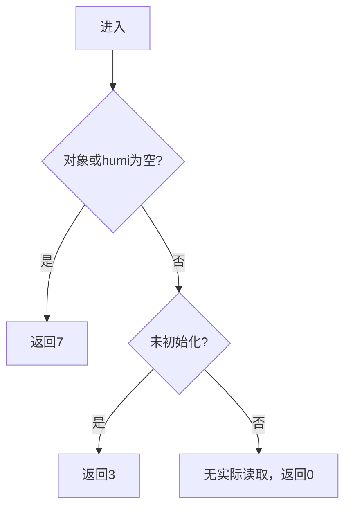

### 7.7 `BspAht21bDriver_Sleep`

#### 7.7.1 函数简介

预留休眠控制接口，当前未发送任何休眠命令。

#### 7.7.2 函数全称及参数表

```c
static BspAht21bStatus_t BspAht21bDriver_Sleep(Bsp_Aht21b_Driver_t * const aht21b_driver);
```

| 方向  | 数据名称            | 类型                      | 描述        |
| --- | --------------- | ----------------------- | --------- |
| 输入  | `aht21b_driver` | `Bsp_Aht21b_Driver_t *` | 驱动对象      |
| 返回  | 状态值             | `BspAht21bStatus_t`     | 参数/状态检查结果 |

#### 7.7.3 交互数据

| 方向  | 数据                | 范围   | 描述    |
| --- | ----------------- | ---- | ----- |
| 读   | `g_aht21b_inited` | 静态变量 | 检查初始化 |

#### 7.7.4 函数调用

| 函数  | 所属组件 | 用途     |
| --- | ---- | ------ |
| 无   | —    | 当前为空实现 |

#### 7.7.5 函数局部变量

| 数据名称 | 类型  | 初值  | 描述    |
| ---- | --- | --- | ----- |
| 无    | —   | —   | 无局部变量 |

#### 7.7.6 函数逻辑描述

检查对象和初始化状态，通过后不改变状态、不访问总线，直接返回成功。

#### 7.7.7 函数流程图

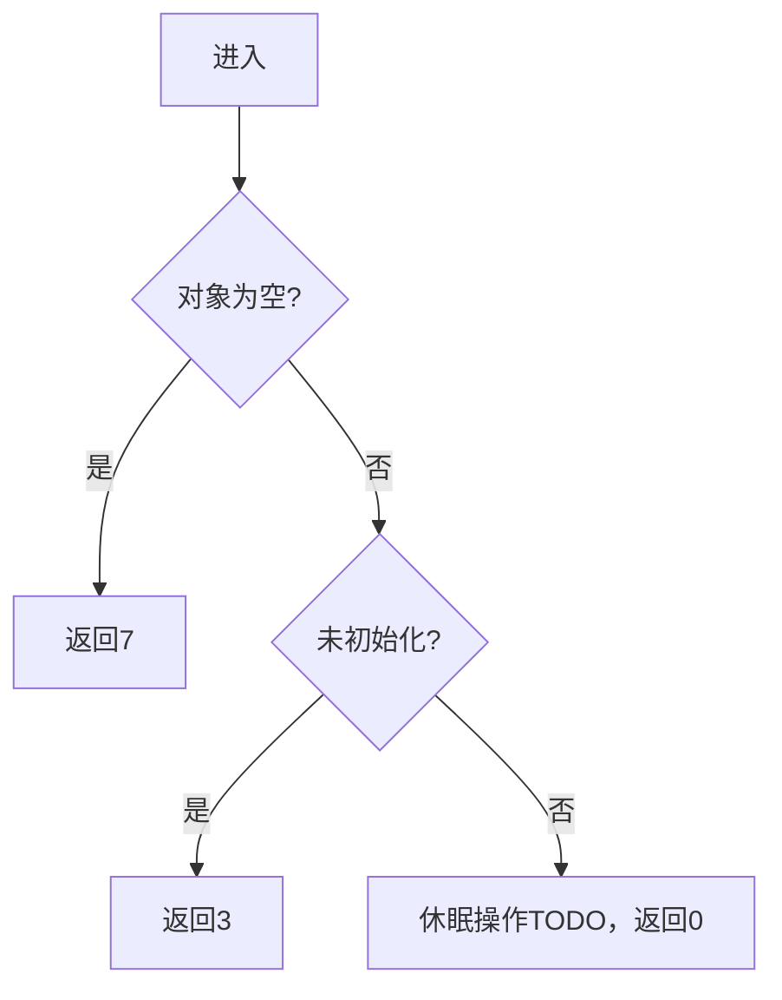

### 7.8 `BspAht21bDriver_WakeUp`

#### 7.8.1 函数简介

预留唤醒控制接口，当前未执行唤醒时序。

#### 7.8.2 函数全称及参数表

```c
static BspAht21bStatus_t BspAht21bDriver_WakeUp(Bsp_Aht21b_Driver_t * const aht21b_driver);
```

| 方向  | 数据名称            | 类型                      | 描述        |
| --- | --------------- | ----------------------- | --------- |
| 输入  | `aht21b_driver` | `Bsp_Aht21b_Driver_t *` | 驱动对象      |
| 返回  | 状态值             | `BspAht21bStatus_t`     | 参数/状态检查结果 |

#### 7.8.3 交互数据

| 方向  | 数据                | 范围   | 描述    |
| --- | ----------------- | ---- | ----- |
| 读   | `g_aht21b_inited` | 静态变量 | 检查初始化 |

#### 7.8.4 函数调用

| 函数  | 所属组件 | 用途     |
| --- | ---- | ------ |
| 无   | —    | 当前为空实现 |

#### 7.8.5 函数局部变量

| 数据名称 | 类型  | 初值  | 描述    |
| ---- | --- | --- | ----- |
| 无    | —   | —   | 无局部变量 |

#### 7.8.6 函数逻辑描述

检查对象和初始化状态，通过后不访问总线，直接返回成功。

#### 7.8.7 函数流程图


### 7.9 `__ReadAht21bID`

#### 7.9.1 函数简介

内部设备 ID 读取辅助函数，目前只完成空指针检查。

#### 7.9.2 函数全称及参数表

```c
static BspAht21bStatus_t __ReadAht21bID(Bsp_Aht21b_Driver_t * const aht21b_driver);
```

| 方向  | 数据名称            | 类型                      | 描述                 |
| --- | --------------- | ----------------------- | ------------------ |
| 输入  | `aht21b_driver` | `Bsp_Aht21b_Driver_t *` | 驱动对象               |
| 返回  | 状态值             | `BspAht21bStatus_t`     | 空指针时返回 7；非空路径当前无返回 |

#### 7.9.3 交互数据

| 方向  | 数据                    | 范围   | 描述                |
| --- | --------------------- | ---- | ----------------- |
| 预期写 | `g_device_id`         | 静态变量 | 预期保存设备 ID，当前未写    |
| 读   | `pIIC_DriverInstance` | 外部接口 | 预期用于 I²C 读取，当前未调用 |

#### 7.9.4 函数调用

| 函数  | 所属组件 | 用途       |
| --- | ---- | -------- |
| 无   | —    | 当前非空路径为空 |

#### 7.9.5 函数局部变量

| 数据名称 | 类型  | 初值  | 描述    |
| ---- | --- | --- | ----- |
| 无    | —   | —   | 无局部变量 |

#### 7.9.6 函数逻辑描述

对象为空返回空指针错误；对象非空时没有读取 ID、没有写全局变量、没有返回状态。

#### 7.9.7 函数流程图

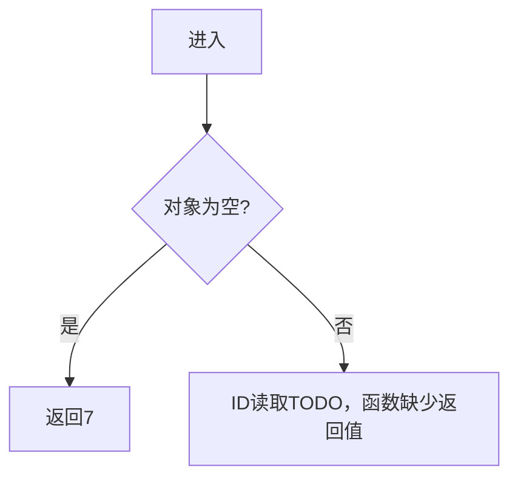

### 7.10 `BspAht21bDriver_GetAht21bID`

#### 7.10.1 函数简介

对外提供设备 ID 的读取接口；当前实现没有返回 `g_device_id`。

#### 7.10.2 函数全称及参数表

```c
static uint32_t BspAht21bDriver_GetAht21bID(Bsp_Aht21b_Driver_t * const aht21b_driver);
```

| 方向  | 数据名称            | 类型                      | 描述                  |
| --- | --------------- | ----------------------- | ------------------- |
| 输入  | `aht21b_driver` | `Bsp_Aht21b_Driver_t *` | 驱动对象                |
| 返回  | ID/错误码          | `uint32_t`              | 设计上应返回 ID；当前非空路径无返回 |

#### 7.10.3 交互数据

| 方向  | 数据            | 范围   | 描述              |
| --- | ------------- | ---- | --------------- |
| 读   | `g_device_id` | 静态变量 | 设计上应作为返回值，当前未读取 |

#### 7.10.4 函数调用

| 函数  | 所属组件 | 用途               |
| --- | ---- | ---------------- |
| 无   | —    | 当前没有调用 ID 读取辅助函数 |

#### 7.10.5 函数局部变量

| 数据名称 | 类型  | 初值  | 描述    |
| ---- | --- | --- | ----- |
| 无    | —   | —   | 无局部变量 |

#### 7.10.6 函数逻辑描述

检查对象；为空时返回数值 7；非空时函数到达末尾，没有返回 ID，属于未定义行为。

#### 7.10.7 函数流程图

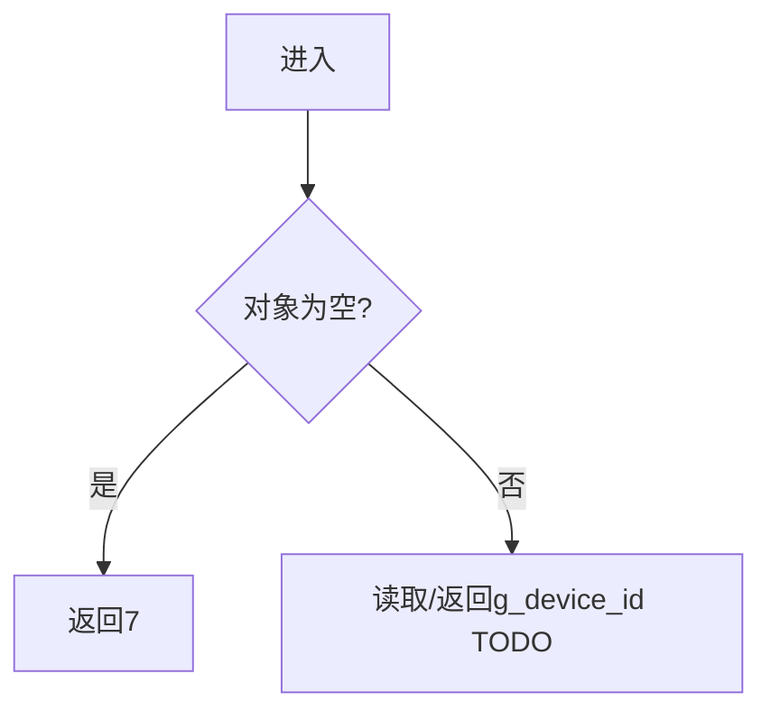

### 7.11 `BspAht21bDriver_CheckCRC8`

#### 7.11.1 函数简介

CRC-8 校验辅助函数。当前仅声明空函数体，没有输入数据、校验过程或返回实现。

#### 7.11.2 函数全称及参数表

```c
static BspAht21bStatus_t BspAht21bDriver_CheckCRC8(void);
```

| 方向  | 数据名称                | 类型  | 描述                  |
| --- | ------------------- | --- | ------------------- |
| 输入  | 无                   | —   | 当前函数没有输入参数          |
| 返回  | `BspAht21bStatus_t` | 枚举  | 设计上应返回 CRC 结果，当前无返回 |

#### 7.11.3 交互数据

| 方向  | 数据                | 范围     | 描述           |
| --- | ----------------- | ------ | ------------ |
| 预期读 | `CRC8_POLYNOMIAL` | 组件宏    | `0x31`，当前未使用 |
| 预期读 | `CRC8_INITAL`     | 组件宏    | `0xFF`，当前未使用 |
| 预期读 | `data_crc`        | 测量函数局部 | 当前未传入本函数     |

#### 7.11.4 函数调用

| 函数  | 所属组件 | 用途   |
| --- | ---- | ---- |
| 无   | —    | 空函数体 |

#### 7.11.5 函数局部变量

| 数据名称 | 类型  | 初值  | 描述    |
| ---- | --- | --- | ----- |
| 无    | —   | —   | 无局部变量 |

#### 7.11.6 函数逻辑描述

当前无执行逻辑。后续应增加数据缓冲区、长度和接收 CRC 参数，按多项式 `0x31`、初值 `0xFF` 计算并比较。

#### 7.11.7 函数流程图

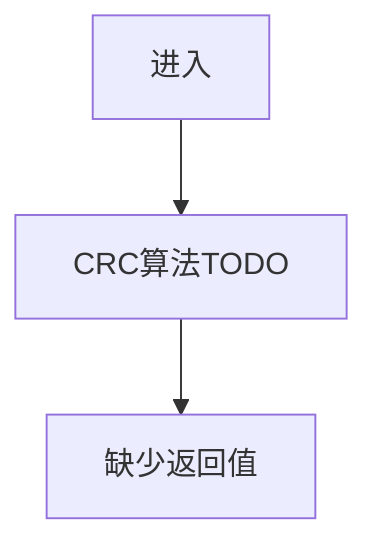

## 8. 框架遗漏检查结果

| 模板要求                | 本版补齐情况 | 说明                          |
| ------------------- | ------ | --------------------------- |
| 目标、参考代码、BSP 层级      | 已覆盖    | 第 1～3 章                     |
| 文件描述、资源、头文件         | 已覆盖    | 第 1.1.1.1～1.1.1.3           |
| 全局宏/类型/变量           | 已覆盖    | 第 1.1.1.4                   |
| 组件宏/类型/变量           | 已覆盖    | 第 1.1.1.5                   |
| 实例化函数七项             | 已补齐    | 第 7.1                       |
| 唤醒函数七项              | 已补齐    | 第 7.8                       |
| 休眠函数七项              | 已补齐    | 第 7.7                       |
| 读湿度函数七项             | 已补齐    | 第 7.6                       |
| 读温湿度函数七项            | 已补齐    | 第 7.5                       |
| 读状态函数七项             | 已补齐    | 第 7.4                       |
| 读 ID 函数七项           | 已补齐    | 第 7.10                      |
| 反初始化函数七项            | 已补齐    | 第 7.3                       |
| 初始化函数七项             | 已补齐    | 第 7.2                       |
| `__ReadAht21bID` 七项 | 已补齐    | 第 7.9                       |
| CRC 辅助函数            | 已补齐    | 第 7.11；该函数在模板中未单列，但源码存在，故增加 |
| 函数调用关系/动态行为         | 已覆盖    | 第 1.1.1.7                   |
| handler 层           | 已明确未提供 | 当前用户提供文件中没有 handler 源码，不能虚构 |

模板原有函数顺序为“实例化、唤醒、休眠、读湿度、读温度、读状态、读 ID、反初始化、初始化、内部读 ID”；本版第 7 章按源码函数名组织，但逐项内容完整对应。 
